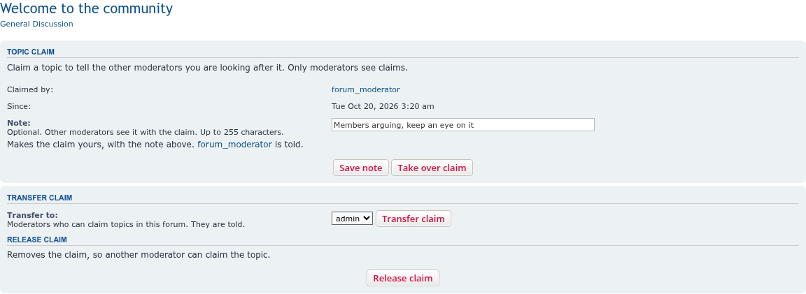
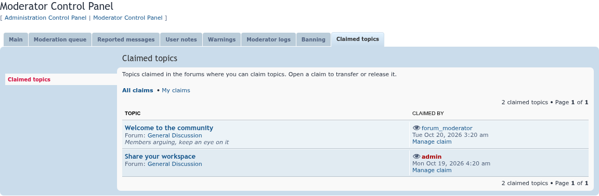

# Topic Claim

 

Lets moderators claim a topic to tell the other moderators they are looking after it, with a list of claims to transfer or release.

## Features

- **Claim a topic** from the topic's **Quick-mod tools**, with an optional short note ("members arguing, keep an eye on it"). One claim per topic.
- **Only moderators see claims.** Claimed topics are marked with an icon and the moderator's name in forum topic lists, topic search results and the MCP forum view, and with a notice below the title on the topic page.
- **MCP → Claimed topics** lists every claim in the forums you can claim in, or only your own, with links to transfer or release each one.
- **Transfer** a claim to another moderator of that forum, **release** it, or change its note. The moderator who holds a claim can do this; so can administrators, who can also **take over** another moderator's claim.
- Moderators are **notified** (on the board, and by email if they choose) when someone else transfers a claim to them, takes over or releases their claim, or gives it to another moderator.
- Every change goes into the **moderator log**.
- **ACP → Extensions → Topic Claim → Settings**: release claims when their topic is locked, release claims after a number of days, and choose the Font Awesome icon (`fa-eye` by default). Both release settings are off by default.
- Claims go away with their topic or their moderator when either is deleted.
- Screen-reader text and labels on the claim marks, notice, list and forms.

The [wiki](https://github.com/phpbbmodders/topicclaim/wiki) has the full documentation: claiming topics, settings and permissions, and troubleshooting.

## Screenshots

<table>
<tr>
<td></td>
<td></td>
<td></td>
</tr>
</table>

Click an image for the full size. See the [screenshot gallery](docs/images/screenshots/README.md) for the rest.

## Permissions

| Permission | Where | Default |
|------------|-------|---------|
| **Can claim topics and see claims** | Moderator permissions → Misc, globally or per forum | Full and Standard Moderator roles |
| **Can take over, transfer and release other moderators' topic claims** | Administrator permissions → Misc | Full and Standard Admin roles |

The administrator permission only works in forums where that administrator can also claim topics.

## Requirements

- phpBB 3.3.19 or later, including phpBB 4.0 (tested on its 4.0.0-a3 development version)
- PHP 7.4 or later (phpBB 4.0 itself needs PHP 8.2 or later)

## Installation

1. Copy the extension to `/ext/phpbbmodders/topicclaim`
2. In the Administration Control Panel, go to **Customise → Manage extensions**
3. Enable the **Topic Claim** extension
4. Optionally choose the release settings and icon under **Extensions → Topic Claim → Settings**

## Contributing

Contributions are welcome!

- **Bug reports**: [Open an issue](https://github.com/phpbbmodders/topicclaim/issues).
- **Everything else** (questions, feature requests, ideas, general discussion): [Use Discussions](https://github.com/orgs/phpbbmodders/discussions), or the [community forum](https://www.phpbbmodders.com/community/).
- Pull requests are welcome for bug fixes or discussed features.

## Acknowledgments

- Based on the idea Holger posted in the phpBB.com Extension Requests forum: [Moderator "ownership"](https://www.phpbb.com/community/viewtopic.php?t=2665171).
- Code, tests and documentation written with [Claude](https://www.anthropic.com/claude).

## License

This extension is licensed under the **GNU General Public License v2.0**.

See [license.txt](license.txt) for more information.
