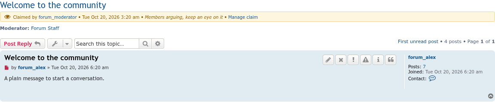
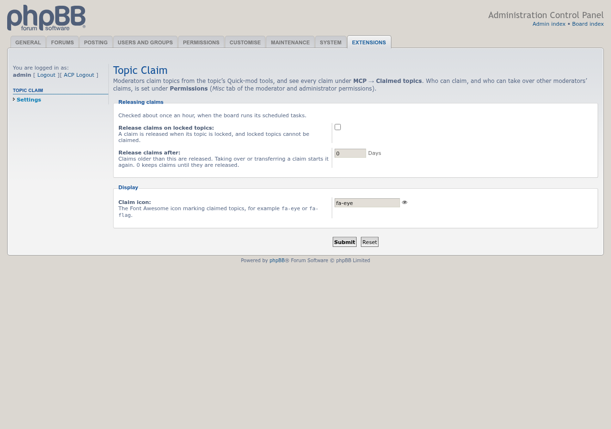

# Topic Claim screenshots

Taken on phpBB 3.3 with prosilver, using `phpbb-test-board/screenshots.py` from [phpbb-release-tools](https://github.com/phpbbmodders/phpbb-release-tools), on a board filled with seed-forum's standard fixtures, with the default settings. The moderator `forum_moderator` has claimed one topic with a note, and the admin has claimed another. Claims show only to moderators, so every screenshot is taken as the admin. Click an image for the full size.

## Forum topic list

Claimed topics show the claim icon (`fa-eye`) and who holds the claim, or "Claimed by you" for your own claims. Hover over the mark to see when the topic was claimed and its note.

## Topic page

A notice below the topic title shows who claimed the topic, when, and the note, with a link to manage the claim.

## Claim page

Opened from the topic's **Quick-mod tools** or the claim marks. An administrator can take over another moderator's claim, transfer it to another moderator of the forum, or release it.

## MCP → Claimed topics

Every claim in the forums you can claim in, or only your own, with a link to manage each one.

## ACP settings

**Extensions → Topic Claim → Settings**: release claims when their topic is locked, release claims after a number of days, and choose the claim icon.

